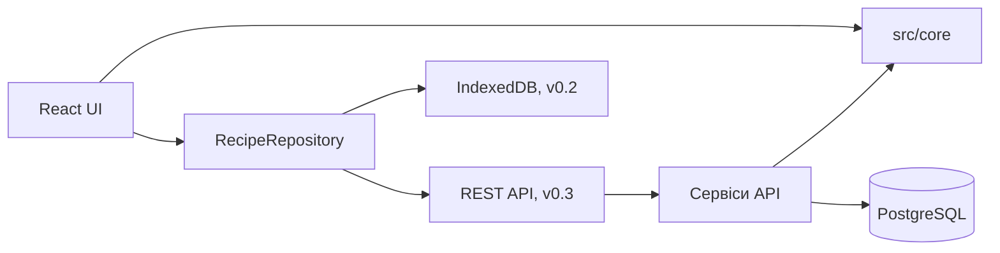
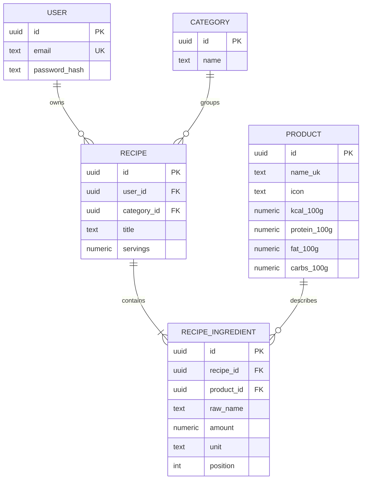

# Архітектура

Залежності спрямовані всередину: інтерфейс і збереження знають про ядро, а ядро не знає про них.

## Етапи

| Версія | Що додається | Нові технології |
| --- | --- | --- |
| v0.1 | Форма, перерахунок, деплой | Vite, React, TypeScript, Vitest |
| v0.2 | Вставка тексту, підказки, збереження | IndexedDB, PWA, Playwright |
| v0.3 | Акаунти, синхронізація, категорії | Node.js, Fastify, PostgreSQL, Drizzle, Docker |
| v0.4 | Розрахунок БЖВ | USDA FoodData Central, міграції даних |

## Модель даних для v0.3

